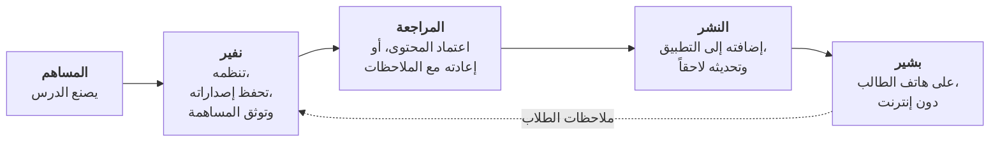
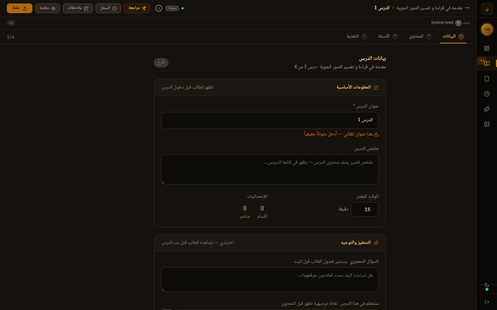
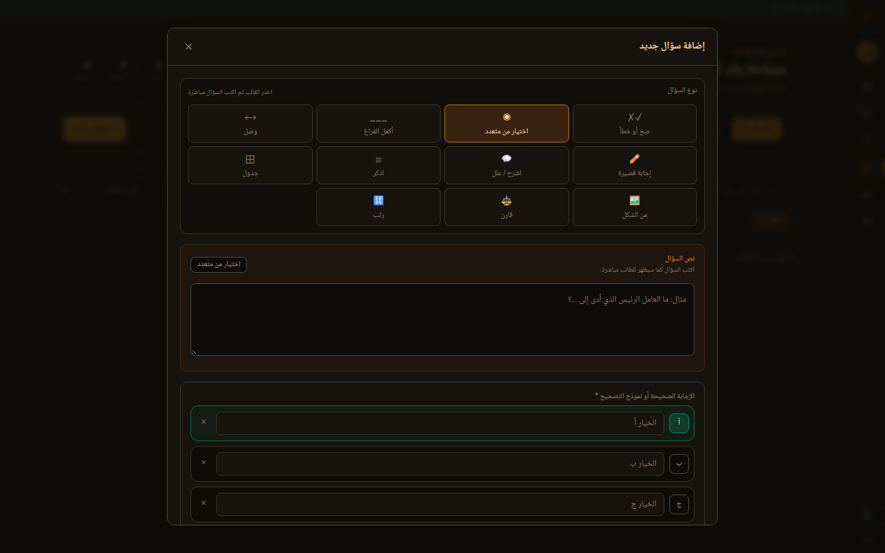
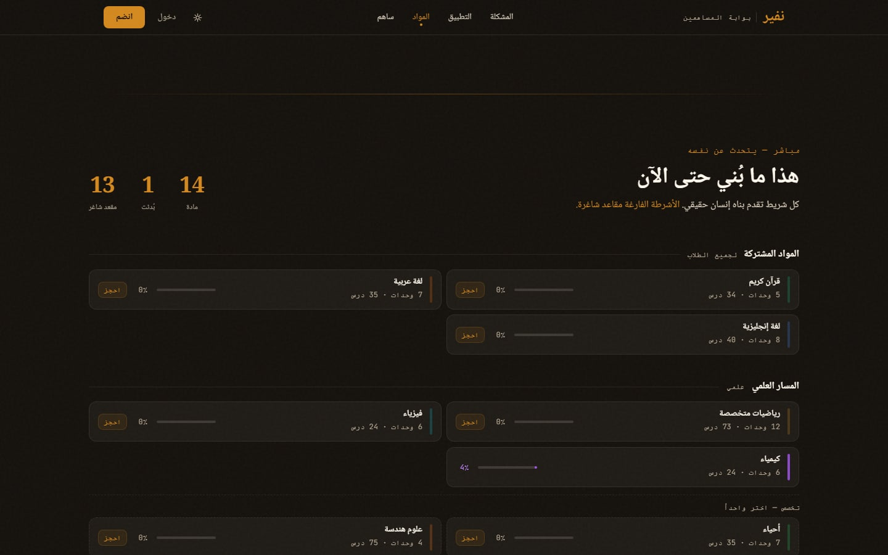
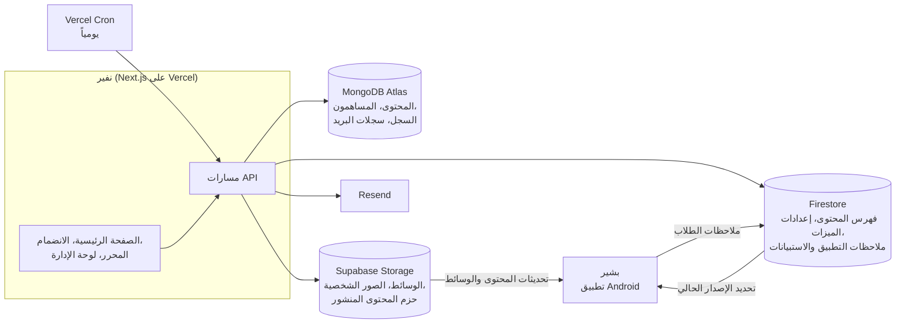

<div align="right">

العربية | [English](README.md)

</div>

<div align="center">


# Nafeer · نفير

### نحن لبعض، والمعرفة البنتشاركها بتصنع فرق.

نفير منصة مجتمعية للمساهمة في تطوير **بشير**، رفيق الشهادة السودانية؛ تطبيق مجاني للمذاكرة، بيشتغل بدون إنترنت، ومخصص لطلاب الشهادة الثانوية في السودان.

بدأت الفكرة من إيمان إنو كل زول عنده معرفة أو خبرة ممكن يشارك بيها، وإنو تعاوننا بيساعد طلابنا يواصلوا تعليمهم مهما كانت الظروف.

[**زيارة الموقع**](https://nafeer4sudan.site) · [**تجربة معاينة بشير**](https://nafeer4sudan.site/demo) · [**انضم كمساهم**](https://nafeer4sudan.site/prejoin)

</div>

<br/>


---

## أولاً: بشير

**بشير** هو رفيق طلاب الشهادة السودانية في رحلة المذاكرة والاستعداد للامتحانات.

استلهمنا بعض أفكاره من Duolingo، زي جلسات المذاكرة القصيرة، والعادات اليومية، والتدريبات البتراعي مستوى الطالب. لكن بشير اتصمم من البداية عشان يناسب واقع الطالب السوداني واحتياجاته، ويخليه يقدر يتعلم ويواصل دراسة حتى بدون إنترنت.
<table>
<tr>
<td width="50%" valign="top">

### 📴 مذاكرتك ما بتتوقف مع الإنترنت

عارفين إنو الاتصال بالإنترنت ما متوفر باستمرار لكل الطلاب في السودان. عشان كدا بشير ما بيعتمد عليه. المنهج موجود داخل التطبيق، والدروس والتدريبات ومتابعة تقدمك كلها شغالة بدون إنترنت.

</td>
<td width="50%" valign="top">

### 🧠 بتعلم من طريقة مذاكرتك

بشير بيتابع شنو درست، وشنو المفاهيم البتلقى فيها صعوبة، وبرجع ليك المعلومة في الوقت المناسب قبل ما تنساها. كمان بجهز ليك تدريبات تساعدك تركز على نقاط ضعفك. وكل دا بيحصل على تلفونك.

</td>
</tr>
<tr>
<td valign="top">

### 📚 المنهج زي ما بتعرفه، لكن بصورة أوضح

بشير ما بيغيّر المنهج السوداني ولا بيستبدله. بنقدم ليك نفس الوحدات والدروس المقررة، لكن بطريقة منظمة وأوضح، فيها رسوم توضيحية وأمثلة محلولة وروابط بتساعدك تفهم العلاقة بين المفاهيم.

</td>
<td valign="top">

### 🎯 استعدادك للشهادة في مكان واحد

امتحانات الشهادة السابقة في قلب بنك الأسئلة، مرتبة حسب المادة والوحدة ومستوى الصعوبة. ومعاها موجز تفاعلي فيه بطاقات تعليمية قصيرة، تقدر تراجع منها حتى في الدقائق الفاضية خلال يومك.

</td>
</tr>
</table>

> ما بندرس عشان نحفظ ونجيب وبس؛ بندرس عشان نفهم ونعرف نبني.
## ثم: نفير

ما ممكن يكون بشير أفضل من المحتوى البقدمه: آلاف الدروس والأسئلة وبطاقات المراجعة، موزعة على أربع عشرة مادة. وكتابة كل المحتوى دا ما مسؤولية شخص واحد.

في السودان، كلمة *نفير* بتعني اجتماع أفراد المجتمع عشان ينجزوا مع بعض حاجة أكبر من قدرة أي زول فيهم لوحده؛ زي بناء بيت أو حصاد محصول. اخترنا الاسم دا للمشروع عن قصد.

**نفير هي الطريقة البتصل بيها معرفة المجتمع دا إلى بشير.**

### لمن صُممت نفير؟

نفير ما للمعلمين وحدهم. أحياناً أفضل شخص يشرح مادة دراسية هو زول درسها، وبعدها استخدم المعرفة دي في حياته العملية:

- **المعلمون والتربويون:** العارفين وين الطلاب غالباً بتواجههم الصعوبات، وكيف يساعدوهم يتجاوزوها.
- **الخريجون وطلاب الجامعات:** الناس القريبين من تجربة الشهادة، والعارفين الحاجات الاتمنوا لو عرفوها قبل الامتحانات.
- **المتخصصون في مجالاتهم:** المهندس البقدر يوضح استخدام قانون فيزيائي في الواقع، والطبيب البيدي درس الأحياء معنى عملي، والمبرمج والمحاسب والمؤرخ وغيرهم.

ما محتاج تكون معلماً. كل البتحتاجه معرفة كويسة بمادتك، وقدرة على شرحها لزول بتعرف عليها لأول مرة.

الفكرة بسيطة: في طالب مستقبله الدراسي مرتبط بالامتحان دا، وشرح واضح من شخص سبقو في الطريق ممكن يفتح ليه أبواب ما كان شايفها.

### شنو البتتولاه نفير عنك؟

أي زول عنده رغبة في المساعدة المفروض يقدر يقعد ويكتب درس، من غير ما يحتاج يتعلم قواعد البيانات، أو كيف التطبيقات بتخزن المحتوى، أو كيف التحديثات بتصل لتلفونات الطلاب.

**نفير موجودة عشان تخلي المساهم يركز على المعرفة ومشاركتها، وتتولى هي التفاصيل التقنية.**
## نفير في لمحة

<table>
<tr>
<td width="50%" valign="top">

### ✍️ اكتب المحتوى، والإعدادات التقنية علينا

بتقدر تبني الدروس من عناصر بسيطة: فقرة، مثال محلول، معادلة، صورة، أو تعريف مميز. والأسئلة بتتجهز باستخدام قوالب جاهزة. ما في حاجة لكتابة كود، أو التعامل مع صيغ ملفات، أو تثبيت برامج.

</td>
<td width="50%" valign="top">

### 🧭 ما حتبدأ من صفحة فاضية

كل مادة مجهزة مسبقاً وفق المنهج الرسمي، بوحداتها ودروسها، مع توضيح المحتوى المكتمل والمواضيع البتنتظر المساهمة. عشان تعرف دائماً وين تبدأ وشنو لسه ناقص.

</td>
</tr>
<tr>
<td valign="top">

### 🏅 جهدك محفوظ باسمك

كل درس بيوثق أسماء الأشخاص المشاركين في كتابته وتحريره ومراجعته. ولكل مساهم ملف شخصي عام، وإحصائيات محدثة، وتقويم للنشاط، وشارات تقدير مرتبطة بإنجازاته الفعلية.

</td>
<td valign="top">

### ✅ ما في محتوى بيصل للطالب دون مراجعة

كل محتوى لازم يمر بالمراجعة والموافقة قبل النشر. وحتى لو عدّلت كلمة واحدة في درس تمت الموافقة عليه، بيرجع للمراجعة من جديد. وكل تعديل محفوظ في إصدار مستقل، مع سجل كامل للتغييرات.

</td>
</tr>
<tr>
<td valign="top">

### 📶 مصممة للاتصالات الضعيفة

المنهج الأساسي موجود داخل التطبيق. ولما نضيف محتوى أو نحسّنه، ما محتاجين الهواتف تنزّل المادة كاملة من جديد؛ بتنزل التغييرات الجديدة بس.

</td>
<td valign="top">

### 🤝 منظومة واحدة، يكمل بعضها بعضاً

صممنا نفير وبشير مع بعض. نفير بتجهز المحتوى بالطريقة البقدر بشير يعرضها، وملاحظات الطلاب بترجع للمساهمين عشان يقدروا يطوّروا المحتوى بناءً على احتياجاتهم.

</td>
</tr>
</table>

## من المساهم إلى الطالب


1. **الكتابة.** يكتب المساهم محتوى الدرس، ويضيف الأسئلة وبطاقات المراجعة، ثم يحفظ عمله.
2. **الإرسال.** بضغطة زر، يرسل الدرس للمراجعة.
3. **المراجعة.** يراجع المحتوى قائد فريق المادة أو مالك المشروع، ويعتمده أو يرجعه للمساهم مع ملاحظات مرتبطة مباشرة بالمواضع التي تحتاج إلى تعديل. وما في زول بقدر يعتمد درسه بنفسه.
4. **النشر.** بعد الاعتماد، يصبح المحتوى جزءاً من بشير. المنهج الأساسي مدمج داخل التطبيق، أما الإضافات والتصحيحات اللاحقة فتصل في تحديثات صغيرة تحتوي فقط على التغييرات.
5. **التعلّم.** يفتح الطالب الدرس ويذاكر، سواء كان متصلاً بالإنترنت أو لا.

## نظرة من الداخل

<table>
<tr>
<td width="50%" valign="top">



**محرر الدروس.** أربع خطوات لإعداد الدرس: التفاصيل، والمحتوى، والأسئلة، وبطاقات المراجعة. وتجد في الشريط العلوي أدوات المراجعة وسجل الإصدارات والملاحظات والمعاينة والحفظ، مع اسم المؤلف ورقم الإصدار أسفله مباشرة.

</td>
<td width="50%" valign="top">



**إضافة سؤال.** اختر نوع السؤال: صح أو خطأ، اختيار من متعدد، توصيل، مقارنة، ترتيب، وغيرها. والنموذج بيتغير تلقائياً حسب اختيارك. ما محتاج تعرف أي شيء تقني عشان تضيف سؤال.

</td>
</tr>
</table>



<sub><b>«هذا ما أُنجز حتى الآن».</b> تعرض لوحة مباشرة في الصفحة الرئيسية جميع المواد ونسبة اكتمال كل منها. وأسفلها رسالة تلخص الفكرة: «كل شريط تقدم أنجزه شخص حقيقي، والأشرطة الفارغة فرص جديدة للمساهمة».</sub>

المنصة بالكامل باللغة العربية، ومصممة من اليمين إلى اليسار، بما في ذلك عرض المعادلات الرياضية وتنسيقها بما يناسب النص العربي.

## توثيق المساهمات جزء من التصميم

صفحة الانضمام بتوعد كل مساهم بحاجة واضحة: *أثر حقيقي، محفوظ باسمك.* ونفير مصممة عشان تفي بالوعد دا:

- **توثيق كل مساهمة.** يسجل النظام من أنشأ المحتوى، ومن عدّله آخر مرة، ومن راجعه.
- **إحصائيات تلقائية.** عدد الدروس والأسئلة وبطاقات المراجعة والتعديلات والمراجعات، وحتى الوقت المستغرق في العمل؛ كلها تُحسب تلقائياً.
- **ملف شخصي عام.** لكل مساهم صفحة قابلة للمشاركة، فيها نبذة عنه، وتقويم لنشاطه، وسلاسل الاستمرارية (Streaks).
- **شارات تقدير.** مستويات البرونز والفضة والذهب، بالإضافة إلى شارات خاصة لإنجازات مثل نشر أول درس، وإتمام عشر مراجعات عالية الجودة، وعضوية التأسيس، وغيرها.
- **الإنجاز أهم من المسودات.** عند اعتماد درس، تُسجل المساهمة لصالح مؤلفه. ويعطي نظام الترتيب وزناً أكبر للدروس المعتمدة والمشاركة في مراجعة أعمال الآخرين، مقارنة بمجرد إنشاء المسودات.
- **مساهمتك ما بتضيع مع الزمن.** يظل الدرس منسوباً للشخص الذي كتبه أو تولى مسؤوليته. وإذا أجرى قائد الفريق تصحيحاً عليه لاحقاً، يُحفظ الاسمان؛ ويعرض الملف الشخصي ما كتبه الشخص وما ساهم في تطويره.

## كيف يُنظّم العمل؟

مشروع بالمحتوى دا محتاج أكثر من مراجع واحد، لكن منح الجميع صلاحيات كاملة ما هو الحل. عشان كدا نفير فيها ثلاثة أدوار، لكل واحد منها صلاحيات محددة:

| الدور | من يشغله؟ | ما الذي يستطيع فعله؟ |
|---|---|---|
| **المساهم (Contributor)** | أي شخص قُبل للمساهمة في مادة معينة | كتابة الدروس وتحسينها، وتولي الدروس غير المسندة، والتعليق على أعمال الآخرين |
| **قائد الفريق (Team Lead)** | مساهم ذو خبرة، يُعيّن لكل مادة. ويمكن أن يكون للمادة قائد واحد أو اثنان يراجع كل منهما عمل الآخر | مراجعة دروس المادة، وتوجيه الفريق، واستقطاب مساهمين، وطلب نشر الإصدارات. ويحدد مالك المشروع الصلاحيات الممنوحة له بشكل منفصل |
| **مالك المشروع (Owner)** | المسؤول عن صيانة المشروع وإدارته | جميع الصلاحيات، بما فيها تعيين قادة الفرق واتخاذ القرار النهائي |

ولضمان عدالة العمل، في قواعد مدمجة في النظام، ما معتمدة على حسن النوايا وحده:

- **ما في زول بيعتمد شغله بنفسه.** تُراجع دروس قائد الفريق بواسطة القائد الآخر أو مالك المشروع.
- **كل قرار يؤثر على مساهم لازم يكون عنده سبب مكتوب.** ويحق للمساهم تقديم استئناف مباشرة إلى مالك المشروع.
- **بعض القرارات عندها فترة انتظار.** يمكن التراجع عن قبول طلب الانضمام أو رفضه خلال 30 دقيقة. أما طلب نشر إصدار يقدمه قائد الفريق، فيظل معلقاً لمدة 3 ساعات، مع إخطار مالك المشروع فوراً وإتاحة الفرصة له لإيقافه.
- **التدخل في عمل مساهم آخر له ضوابط.** يمكن لقائد الفريق التدخل في درس أحد الأعضاء لمدة 24 ساعة، بشرط توضيح السبب للمؤلف وتسجيل كل تعديل باسم القائد.
- **كل تصرفات قادة الفرق موثقة.** تُجمع في سجل واحد يراجعه مالك المشروع، مع ملخص يومي للنشاط.

التفاصيل الكاملة موضحة في [docs/team-leads.md](docs/team-leads.md).

## وين وصل المشروع؟

نفير نظام شغال فعلياً، بناه وبيصونه شخص واحد، وبيستعد حالياً لاستقبال أول مجموعة من المساهمين. معظم المواد لسه ما اكتمل محتواها، ودا تحديداً الغرض من لوحة متابعة التقدم: توضح شنو اتنجز وشنو لسه محتاج مساهمة.

| الحالة | التفاصيل |
|---|---|
| **شغال حالياً** | نظام انضمام بمقابلة مكتوبة · محرر متكامل مع الحفظ التلقائي · إدارة الإصدارات وسجل التعديلات والملاحظات · مراجعة بتعليقات مرتبطة بمواضعها · قادة فرق لكل مادة بصلاحيات المراجعة والاستقطاب والنشر · ملكية الدروس وآلية موثقة لتدخل قائد الفريق · نظام الاستئناف · ملفات المساهمين وإحصائياتهم وشاراتهم · تتبع تغطية المنهج · نشر التغييرات فقط إلى التطبيق · لوحة تحكم إدارية · بريد إلكتروني بملخصات يومية · إعادة تعيين كلمة المرور ذاتياً · فحوصات CI تلقائية عند طلبات الدمج (Pull Requests) والدفع إلى `main` · الإعلانات والاستبيانات وملاحظات الطلاب · معاينة تفاعلية لبشير · حماية من تعارض التعديلات عند الحفظ المتزامن · تحديد معدل الطلبات على تسجيل الدخول والنماذج العامة، مع ترويسات الأمان · اختبارات آلية · قاعدة بيانات تطوير منفصلة وحسابات تجريبية |
| **مكتمل جزئياً** | سجل الإصدارات يقارن تفاصيل الدرس، لكن ليس كل كتلة محتوى بصورة منفصلة · توجد تنويعات للدروس، لكنها لا تدخل في حساب نسبة التغطية · لا يمكن الرجوع بإصدار منشور إلى إصدار أقدم؛ يمكن بدلاً من ذلك تعطيل المادة في التطبيق ونشر إصلاح جديد · إرسال رسائل رفض الطلبات ما زال يدوياً |
| **ضمن خارطة الطريق** | إضافة محتوى أول عامين من المرحلة الثانوية · تحديات للطلاب ولوحات متصدرين · شروحات تتكيف مع مستوى المتعلم · مختبر تفاعلي للعلوم والرياضيات |
---

## ما وراء الكواليس

اختيرت التقنيات لتكون مألوفة وبسيطة قدر الإمكان. أما الجزء الجدير بالاهتمام فهو طريقة تنظيمها لإبعاد التعقيد عن المساهمين، وتقليل حجم التنزيلات على هواتف الطلاب.

| الطبقة | التقنية |
|---|---|
| تطبيق الويب | Next.js 15, React 19, Tailwind CSS, JavaScript عادي |
| قاعدة بيانات العمل | MongoDB Atlas (Mongoose) |
| الملفات والمحتوى المنشور | Supabase Storage |
| مصدر المحتوى الذي يقرأه التطبيق | Firebase Firestore |
| البريد الإلكتروني | Resend |
| المهام المجدولة | Vercel Cron، مرة واحدة يومياً |
| الاختبارات | Vitest |
| تقنيات أخرى | Zustand (حالة المحرر)، KaTeX (الرياضيات)، sharp (الصور)، dnd-kit (السحب والإفلات)، GSAP (الرسوم المتحركة) |
| الاستضافة | Vercel. يعمل المشروع بالكامل ضمن الخطط المجانية، وصُمم بحيث لا يحتاج إلى خدمات مدفوعة، أو طلبات استطلاع متكررة (Polling)، أو عمليات خلفية دائمة. |

<details>
<summary><b>البنية المعمارية (Architecture)</b></summary>

<br/>



**MongoDB هي نسخة العمل.** كل ما يكتبه المساهمون يُحفظ فيها مع سجل تعديلاته. ولا تتصل هواتف الطلاب بها مطلقاً.

**Firestore وSupabase هما نسخة المحتوى المنشور.** عند النشر، تُكتب حزم المحتوى في مساحة التخزين، ويُحدّث فهرس واحد لتحديد المحتوى المتاح حالياً.

هذا الفصل يعني أن نظام التحرير يمكن أن يكون بطيئاً أو تجريبياً أو حتى متوقفاً مؤقتاً، دون أن يؤثر ذلك في الطلاب.

**تُحدد الصلاحيات على الخادم عند كل طلب.** تخبر جلسة المساهم النظام بهويته، أما ما يُسمح له بالوصول إليه فيُتحقق منه من جديد في كل مرة: المادة المسندة إليه، وهل هو قائد فريقها، وما الصلاحيات التي يملكها، وهل يملك الدرس، وهل حسابه موقوف مؤقتاً. إذا سُحبت صلاحية من شخص، يسري ذلك من الطلب التالي مباشرة، ولا يحتاج إلى انتظار انتهاء الجلسة.

للمحتوى بنية ثابتة:

```text
Subject → Units → Lessons → Sections → Blocks      ما يقرأه الطالب
Concepts → Study cards                              ما يراجعه الطالب
Questions → Exams                                   ما يتدرب عليه الطالب
```

تربط المفاهيم بين هذه العناصر الثلاثة: إذ يمكن ربط مفهوم واحد بالقسم الذي يشرحه، وبطاقات المراجعة التي تدرب عليه، والأسئلة التي تختبر فهمه.

</details>
<details>
<summary><b>كيف تعمل عملية النشر؟</b></summary>

<br/>

يحصل بشير على المحتوى بطريقتين. أولاً، يُصدّر المنهج الأساسي من نفير ويُدمج داخل التطبيق، حتى تكون النسخة الجديدة جاهزة للمذاكرة دون الحاجة إلى الإنترنت. بعد ذلك، تصل الإضافات والتصحيحات عبر التحديثات الشبكية (Over-the-air).

تتولى هذه العملية **آلية فروقات المحتوى (Delta Engine)**. مع كل عملية نشر، تقوم بما يلي:

- تجمع جميع العناصر المعتمدة للمادة.
- تنشئ بصمة رقمية (Fingerprint) لكل عنصر، اعتماداً على معرّفه ووقت آخر تعديل عليه.
- تقارن البصمات بالإصدار السابق لتحديد العناصر الجديدة أو المعدلة أو المحذوفة.
- تحزم التغييرات فقط في ملفات تحمل أسماء مشتقة من محتواها، لتجنب رفع الملف نفسه أكثر من مرة.

تُرقّم إصدارات المحتوى بصيغة `MAJOR.patch`. يرتفع رقم `patch` تلقائياً عند وجود تغييرات فعلية، بينما يُرفع رقم `MAJOR` يدوياً عند إصدار تحديث جوهري. وإذا لم يتغير المحتوى، فلا يُنشأ أي إصدار جديد.

يتوفر أيضاً خيار تصدير المادة كاملة، لاستخدامه في بناء النسخة الأساسية المدمجة داخل التطبيق أو استعادة محتواها.

قبل النشر، يمكن تشغيل العملية في وضع **التجربة (Dry Run)**. يعمل خط المعالجة بالكامل، لكنه يتوقف قبل رفع الملفات، ويعرض بالتحديد التغييرات التي كان سينفذها. يستطيع قائد الفريق معاينة النتيجة قبل تقديم طلب النشر.

بعد تقديم الطلب، يدخل الإصدار فترة تعليق مدتها ثلاث ساعات، يُخطر خلالها مالك المشروع ويستطيع إلغاء العملية. وبعد انتهاء الفترة، يُنفذ النشر باستخدام الشيفرة نفسها المستخدمة في النشر بواسطة مالك المشروع. ويظل بإمكان المالك تعطيل المادة في التطبيق في أي وقت.

توجد آلية النشر في الملفات [`deltaEngine.js`](Nafeer/src/lib/deltaEngine.js)، و[`publishSubject.js`](Nafeer/src/lib/publishSubject.js)، و[`releases.js`](Nafeer/src/lib/releases.js).

</details>

<details>
<summary><b>قرارات التصميم</b></summary>

<br/>

- **انشر المحتوى، ولا تقدمه مباشرة من قاعدة التحرير.** لا يتصل التطبيق بقاعدة بيانات التحرير مباشرة. يتطلب ذلك خطوة نشر صريحة، لكنه يضمن استمرار عمل التطبيق بصرف النظر عن حالة منصة إدارة المحتوى.
- **فهرس موحد ومعرّفات ثابتة.** يحدد الملف [`curriculum.js`](Nafeer/src/shared/curriculum.js) جميع المواد والوحدات وخانات الدروس. وتظل المعرّفات، مثل `GEOGRAPHY_U1_L1`، ثابتة حتى لا يؤدي تغيير عنوان الدرس إلى فقدان تقدم الطالب.
- **أنواع المحتوى تمثل عقداً مشتركاً.** يعكس الملف [`constants.js`](Nafeer/src/shared/constants.js) تعريفات أنواع المحتوى المستخدمة في التطبيق، وتُنشأ قوائم المحرر اعتماداً عليه.
- **مصدر واحد لإدارة الإصدارات.** تتولى دالة مركزية تحديث أرقام الإصدارات لجميع أنواع المحتوى. وهي أيضاً تفرض قاعدة إعادة المحتوى المعتمد إلى المسودة عند تعديله، حتى لا تضطر كل ميزة جديدة إلى تنفيذ هذه القاعدة بنفسها.
- **توثيق المساهمات لا يعطل العمل.** تُحدّث عدادات المساهمات في الخلفية، ويُسمح بفشل هذه العملية دون التأثير في الوظائف الأساسية.
- **الشارات تُحسب ولا تُخزّن.** بذلك تظل نتائجها متوافقة مع شروط الحصول عليها، حتى عند تعديل تلك الشروط مستقبلاً.
- **التحرير المحلي أولاً (Local-first).** يحدّث المحرر الواجهة فوراً، وينشئ المعرّفات داخل المتصفح، ولا يرسل إلى الخادم إلا التغييرات. يتم الحفظ بعد فترة قصيرة من التوقف عن الكتابة، وكذلك عند مغادرة الدرس.
- **التحقق من التعديلات بدلاً من استبدالها عشوائياً.** يحمل كل عنصر محفوظ رقم إصدار، ولا يُقبل الحفظ إلا إذا كان مبنياً على الإصدار الذي بدأ المحرر العمل عليه. إذا عدّل شخصان الكتلة نفسها، لا يُمحى عمل أي منهما؛ بل تظهر النسختان مع إبراز الاختلافات، ويختار المستخدم النسخة التي يريد الاحتفاظ بها.
- **جلسات منفصلة للمساهمين والإدارة.** لا يستطيع المساهم الوصول إلا إلى المادة المسندة إليه، ويُتحقق من الصلاحيات على الخادم مع كل طلب.
- **الصلاحيات بدلاً من الرتب.** لا توجد مستويات يصعد فيها المستخدم. ترتبط كل عملية محمية بصلاحية محددة داخل مادة معينة. لذلك يكون قائد الفيزياء مساهماً عادياً في الجغرافيا، ويمكن منحه صلاحية المراجعة قبل منحه صلاحية النشر.
- **لكل درس مالك واحد.** لا يعدّل الدرس إلا مالكه، ولا يمكن لأحد تغيير هيكل المنهج الأساسي عن طريق الخطأ؛ إذ يتطلب ذلك إجراءً مقصوداً وواضحاً. أما الآخرون، فيستطيعون القراءة والتعليق مع الاحتفاظ بحقوق مساهماتهم.
- **سجل تدقيق موحد.** يُسجل كل قرار يتخذه قائد الفريق في سجل واحد لا تُحذف إدخالاته، مع توضيح أسباب القرارات. بذلك تصبح الرقابة عملية يمكن مراجعتها والاستعلام عنها، بدلاً من تحويلها إلى تحقيق معقد.
- **فترات انتظار دون خوادم إضافية.** تتطلب فترات التراجع عن القرارات وتعليق النشر عملية تنفذ الإجراء عند انتهاء المهلة. وبدلاً من الاعتماد على خدمة جدولة مدفوعة، تلتقط الطلبات الاعتيادية المهام التي حان موعدها، إلى جانب مهمة يومية احتياطية. وقبل تنفيذ أي خطوة، تحجز العملية المهمة أولاً لمنع تنفيذها مرتين.

</details>

<details>
<summary><b>الاختبارات وبيئة تطوير آمنة</b></summary>

<br/>

**مجموعة الاختبارات (Test Suite).** باستخدام Vitest، تعمل المجموعة خلال ثوانٍ ودون الحاجة إلى قاعدة بيانات. تضم حالياً 449 اختباراً موزعة على 33 ملفاً، وتركز على الأجزاء التي قد يؤدي تعطلها إلى أكبر ضرر:

- **التحكم في الوصول.** اختبار الصلاحيات مع مختلف أنواع المستخدمين: المساهم، وقائد المادة، وقائد مادة أخرى، والقائد الذي لا يملك الصلاحية المطلوبة، ومالك المشروع. وتشمل الاختبارات المساهمين الموقوفين مؤقتاً، وملكية الدروس، وقاعدة منع اعتماد الشخص لعمله بنفسه.
- **مسارات العمل.** المراجعة وإعادة الإرسال، والتدخل في الدروس، وقرارات قبول المساهمين وفترة التراجع عنها، وعمليات النشر وفترة تعليقها، والاستئنافات، والملخصات اليومية.
- **سلامة البيانات.** تعارض التعديلات بين شخصين، وإدارة الإصدارات، والمزامنة المحلية للمحرر، وحدود الطلبات، ومعالجة الصور.
- **اختبارات تفحص الشيفرة نفسها.** يوجد اختباران يفحصان جميع المسارات البرمجية التي تكتب المحتوى، ويفشلان إذا أغفل أي مسار التحقق من صلاحية المستخدم أو ملكية الدرس. وهذا يساعد على منع أي ميزة جديدة من تجاوز قواعد الوصول دون اكتشاف ذلك.

**قاعدة بيانات تطوير منفصلة.** لا تتصل بيئة التطوير المحلية بالبيانات الحقيقية مطلقاً. فهي تستخدم قاعدة بيانات مستقلة باسم `nafeer_dev` ضمن المجموعة نفسها، مع آلية حماية تمنع أدوات التطوير من العمل على أي قاعدة أخرى.

في هذه البيئة، تُطبع رسائل البريد بدلاً من إرسالها، وتُمنع عمليات النشر الفعلية إلى التطبيق، مع السماح بمعاينة Dry Run.

**حسابات تجريبية لمختلف الحالات.** ينشئ أمر واحد قاعدة التطوير ويملؤها بمنهج مادة محددة ومجموعة من الحسابات، تشمل: قائداً يمتلك جميع الصلاحيات، وقائداً ثانياً، ومساهمين لديهم دروس قيد المراجعة أو معادة إليهم أو مهملة، ومساهمًا موقوفاً مؤقتاً، وقائداً لمادة أخرى، ومتقدمين للانضمام.

وتتيح صفحة مخصصة في بيئة التطوير تسجيل الدخول بأي حساب بضغطة واحدة، بحيث يمكن تجربة مسارات العمل من وجهة نظر كل دور خلال دقيقة واحدة.

التفاصيل: [`docs/dev-database.md`](docs/dev-database.md).

</details>

<details>
<summary><b>تشغيل المشروع محلياً</b></summary>

<br/>

تحتاج إلى Node.js الإصدار 20 أو أحدث، بالإضافة إلى قاعدة بيانات MongoDB ومشروع Supabase ومشروع Firebase خاصين بك.

```bash
cd Nafeer
```

```bash
npm install
```

أنشئ الملف `Nafeer/.env.local`:

```bash
MONGODB_URI=
JWT_SECRET=                   # سلسلة عشوائية طويلة: openssl rand -base64 32
NEXT_PUBLIC_APP_URL=http://localhost:3000

NEXT_PUBLIC_SUPABASE_URL=
SUPABASE_SERVICE_ROLE_KEY=
SUPABASE_MEDIA_BUCKET=basheer-media
SUPABASE_USERS_BUCKET=nafeer-users
SUPABASE_EXPORTS_BUCKET=content-exports

FIREBASE_PROJECT_ID=
FIREBASE_CLIENT_EMAIL=
FIREBASE_PRIVATE_KEY=

RESEND_API_KEY=               # اختياري
RESEND_WEBHOOK_SECRET=
EMAIL_FROM=
EMAIL_REPLY_TO=

ADMIN_USERNAME=               # يُستخدم مرة واحدة بواسطة seed script
ADMIN_PASSWORD=
ADMIN_EMAIL=

CRON_SECRET=                  # في الإنتاج: لحماية المهمة اليومية (openssl rand -hex 32)
```

وجّه بيئة التطوير إلى قاعدة بياناتها الخاصة بإنشاء الملف `Nafeer/.env.development.local`. يقرأ Next.js هذا الملف عند تشغيل `npm run dev` فقط، ولا يستخدمه أثناء عمليات البناء أو في بيئة الإنتاج:

```bash
MONGODB_DB=nafeer_dev
```

املأ قاعدة البيانات بالأدوار، وحساب المدير الأول، والمنهج، والحسابات التجريبية، ثم شغّل الخادم:

```bash
npm run seed:dev
```

```bash
npm run dev
```

سيعمل الموقع على العنوان `http://localhost:3000`. افتح `http://localhost:3000/dev/login` لتسجيل الدخول باستخدام أي حساب تجريبي أو حساب المدير.

أما قاعدة بيانات الإنتاج، فينشئ الأمر `npm run seed` الأدوار الافتراضية وحساب المدير الأول فقط.

لتشغيل الاختبارات (Vitest، ولا تحتاج إلى قاعدة بيانات):

```bash
npm test
```

يجب ضبط `JWT_SECRET` في جميع البيئات باستثناء حاسوبك الشخصي. إذا لم يتم ضبطه، ستستخدم بيئة التطوير مفتاحاً مؤقتاً، بينما ترفض بيئة الإنتاج إنشاء الجلسات أو قبولها تماماً.

في بيئة الإنتاج، اضبط `CRON_SECRET` في Vercel. يرسل Vercel هذه القيمة مع كل استدعاء مجدول، وترفض المهمة اليومية العمل دونها.

</details>

<details>
<summary><b>التعرّف على بنية المشروع</b></summary>

<br/>

| المسار | المحتوى |
|---|---|
| [`Nafeer/src/app`](Nafeer/src/app) | الصفحات ومسارات API: مجلد `editor/` للمساهمين وقادة الفرق، و`admin/` للمالك، و`api/` لكل ما يستدعيه المتصفح |
| [`Nafeer/src/lib`](Nafeer/src/lib) | القواعد والمنطق: [`api/guard.js`](Nafeer/src/lib/api/guard.js) (من يستطيع فعل ماذا)، و[`leads.js`](Nafeer/src/lib/leads.js)، و[`lessonAccess.js`](Nafeer/src/lib/lessonAccess.js)، و[`review.js`](Nafeer/src/lib/review.js)، و[`audit.js`](Nafeer/src/lib/audit.js)، وخط معالجة النشر |
| [`Nafeer/src/lib/models`](Nafeer/src/lib/models) | مخططات قاعدة البيانات |
| [`Nafeer/src/shared`](Nafeer/src/shared) | فهرس المنهج وأنواع المحتوى المشتركة مع التطبيق |
| [`Nafeer/src/components`](Nafeer/src/components) | واجهة المستخدم: `ui/` لنظام التصميم، و`editor/` للمحرر |
| [`Nafeer/tests`](Nafeer/tests) | مجموعة الاختبارات |
| [`Nafeer/scripts`](Nafeer/scripts) | تهيئة قواعد البيانات ومهام الصيانة |
| [`docs/team-leads.md`](docs/team-leads.md) | الأدوار والصلاحيات والضمانات: التصميم الكامل، وما تم تنفيذه في كل مرحلة |
| [`docs/dev-database.md`](docs/dev-database.md) | قاعدة بيانات التطوير والحسابات التجريبية |
| [`docs/design-system.md`](docs/design-system.md) | نظام التصميم المرئي |

</details>

---

## جرّب بشير

مستودع بشير نفسه خاص في الوقت الحالي، ما دام التطبيق قيد التطوير. لكن يمكنك استكشاف معاينة تفاعلية له مباشرة من المتصفح عبر [nafeer4sudan.site/demo](https://nafeer4sudan.site/demo).

## القصة

صُمم وبُني كل من نفير وبشير بواسطة **الطيب عبدالجليل** (Altayeb Abdeljalil).

في عام 2024، كان يعيد دراسة الرياضيات والإحصاء استعداداً للانتقال إلى مجال الذكاء الاصطناعي، وبدأ يلاحظ أموراً سبق أن درسها في المدرسة. فالفيزياء التي تعلمها في المدرسة تفسر طريقة عمل المحركات الحديثة، والرياضيات التي حفظها اتضح أنها لغة الخوارزميات المستخدمة اليوم. لكن لم يخبره أحد بهذه الروابط حين كان يدرسها.

خرج من تلك التجربة بقناعة أن المنهج السوداني متين في أساسه، لكنه يُدرّس بمعزل عن السياق: دون ربط كافٍ بالعالم الأوسع أو توضيح للعلاقات بين المفاهيم. بشير محاولة لإضافة ما كان ينقص، لا لتغيير المنهج. أما نفير، فهي اعتراف بأن شخصاً واحداً لا يستطيع كتابة كل هذا المحتوى بمفرده.

[الموقع الشخصي](https://altyeb.my) · [GitHub @altyebv](https://github.com/altyebv) · [LinkedIn](https://www.linkedin.com/in/altyebv)

إذا كنت معلماً، أو خريجاً، أو شخصاً يعرف مادة دراسية جيداً، فإن [دليل المساهم](https://nafeer4sudan.site/prejoin) هو المكان المناسب للبدء.

## الترخيص

يُصدر كود نفير بموجب [رخصة GNU Affero General Public License v3.0](LICENSE). يمكنك الاطلاع عليها وتشغيلها وتعديلها ومشاركتها. وإذا وزعت نسخة معدلة منها، أو شغّلتها كخدمة للآخرين، فيجب عليك إتاحة تعديلاتك بموجب الرخصة نفسها.

لا تشمل هذه الرخصة اسمي نفير وبشير أو شعاريهما. كما أن المحتوى التعليمي الذي يكتبه المساهمون محفوظ داخل المنصة، وليس ضمن هذا المستودع.

حقوق النشر © 2024–2026 الطيب عبدالجليل.

<div align="center">
<br/>

*ما لا يبنيه شخص واحد، يبنيه النفير*<br/>
<sub>What one person cannot build, the nafeer builds.</sub>

</div>